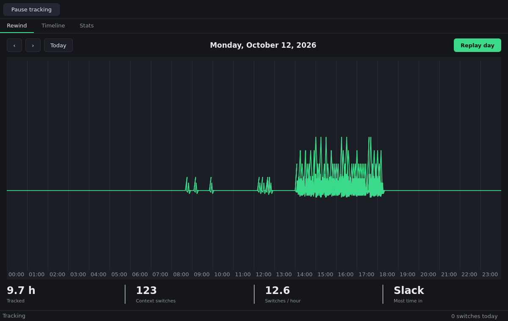
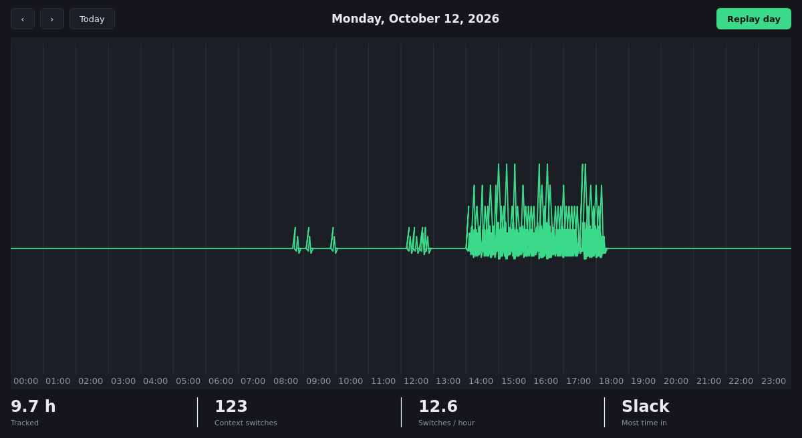
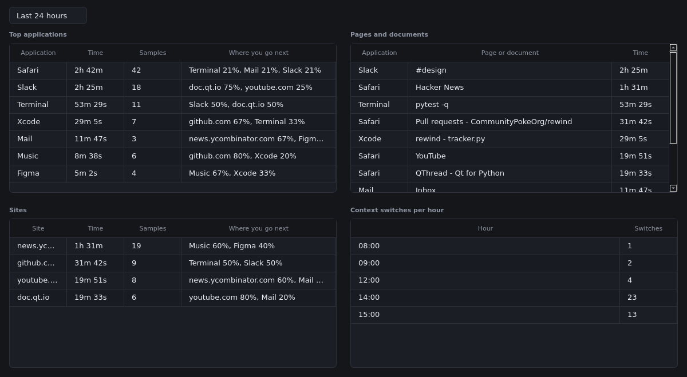
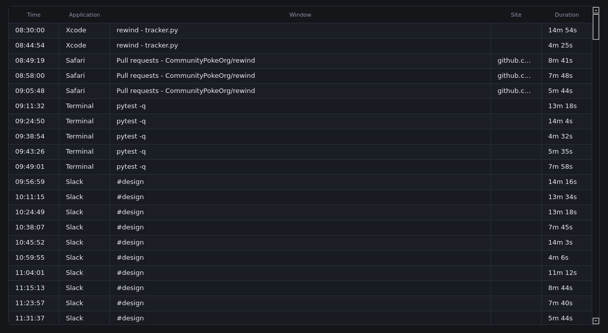

# Rewind

A **macOS, local-first time tracker** that watches your attention like a heart
monitor. Rewind passively records which app and window is in front, counts your
context switches, and replays the day as a pond of expanding ripples so you
can *see* where your focus fragmented.

## What it tracks (and what it never does)

- Frontmost application (name, bundle id, PID) via `NSWorkspace`.
- Front window title via the window server / Accessibility API.
- Active browser **tab title and URL** for known browsers via AppleScript
  (Safari, Chrome, Brave, Edge, Arc; Zen attempted), reduced to a **domain**
  (github.com, youtube.com) so dwell time aggregates per site.
- Context switches between frontmost processes, with a fragmentation rate
  (switches per minute/hour) over time.
- **Transitions**: consecutive event pairs reveal where attention goes
  next — each top app/site shows its top-3 immediate destinations
  ("Where you go next").

**Privacy:** no screenshots, no keylogging, no network calls, no content
capture — local metadata only, stored in a SQLite database on your machine.

## Requirements

- macOS 13+ (Cocoa/Quartz APIs)
- Python 3.12+
- PySide6 (Qt for Python)

## Setup

```bash
git clone https://github.com/CommunityPokeOrg/rewind.git
cd rewind
python3.12 -m venv .venv && source .venv/bin/activate
pip install -r requirements.txt     # or: pip install -e .
```

Run it:

```bash
python -m rewind        # or just `rewind` if installed with pip install -e .
```

## macOS permissions

Rewind works with reduced data when permissions are missing — nothing breaks:

- **Accessibility** (System Settings → Privacy & Security → Accessibility):
  lets Rewind read front window titles when the window server redacts them.
- **Automation** (prompted on first use, per browser): lets AppleScript read
  the active tab's title **and URL** (Safari/Chrome/Brave/Edge/Arc; Zen's
  scripting bridge is limited and commonly declines — Rewind then records
  just its window title). Deny it and Rewind still records the browser's
  window title, without the domain.

## Where your data lives

`~/Library/Application Support/Rewind/rewind.db` — SQLite in **WAL mode** so
the background poller (a `QThread`) and the UI can share it safely.

Schema (migrated via `PRAGMA user_version`): `events` (timestamp, app name,
bundle id, window title, pid, duration, **domain**) and `switches`
(timestamp, from/to pid, from/to app).

## Using it

- **Rewind tab** — the pond: every context switch drops a ripple ring at
  its moment on the timeline, labeled with the app or site. Long focus
  sessions land as wide, slow rings; sub-30-second checks are droplets
  that dissipate fast. Pick a **timeframe** (Last 24 hours / 12 / 6 /
  Today), step the window with `‹`/`›`, hit **Replay** to sweep the
  playhead, or drag the scrubber to seek.
- **Timeline tab** — every observation, chronologically, including the
  site behind each browser event.
- **Stats tab** — recomputed for the same timeframes: top apps, **sites**,
  exact **pages/documents** by dwell time, switches per hour, and a
  **Where you go next** column listing each item's top-3 immediate
  destinations with percentages.
- The toolbar's **Pause tracking** stops the poller; Resume picks it back up.

## Project layout

```
rewind/
  app.py            # QApplication entry point
  ui.py             # main window, tabs, tracking toggle
  tracker.py        # NSWorkspace / Quartz / AppleScript sampler (macOS)
  workers.py        # QThread poller -> EventStore + Qt signals
  switches.py       # context-switch counter + fragmentation math (pure)
  transitions.py    # 'where you go next' consecutive-pair aggregation (pure)
  db.py             # SQLite WAL schema, migrations + range queries (pure)
  theme.py          # design tokens (color/type/spacing) + central QSS
  views/            # RewindView, TimelineView, StatsView, TimeframeSelector
  widgets/          # RippleWidget (custom-painted pond-ripple canvas)
tools/
  capture_screenshots.py  # offscreen PNG renders into docs/screenshots/
  capture_replay_mp4.py   # Xvfb + ffmpeg MP4 of the ripple replay
docs/screenshots/   # rendered UI screenshots + replay MP4
tests/              # pytest suite for the pure modules
```

## The interface

A single dark, slate-charcoal window: a slim toolbar strip on top (Pause
tracking), three tabs, and a status bar at the bottom.

- **Rewind** — day navigation, the ripple canvas (hour grid, one
  expanding ring per active block, replay playhead + scrubber), and a
  hairline-divided metric strip: tracked hours, context switches,
  switches/hour, most-used app.
- **Timeline** — the day's observations in a hairline-gridded table.
- **Stats** — top apps, sites, pages/documents, switches per hour, and
  "Where you go next" transitions, all scoped to the timeframe selector.

The visual system lives in `rewind/theme.py`: one accent color (phosphor
green, the trace itself), one radius scale, hairline borders and negative
space instead of card chrome, and a system type stack. Views consume tokens;
the stylesheet is generated once by `theme.stylesheet()`.






Replay scrubber in action:

[Replay playhead rippling across the pond](docs/screenshots/rewind-ripple-replay.mp4)

Regenerate the docs images against a seeded day (works headless):

```bash
QT_QPA_PLATFORM=offscreen python tools/capture_screenshots.py
xvfb-run -a python tools/capture_replay_mp4.py   # needs ffmpeg
```

## Tests

```bash
pip install pytest
pytest
```

(The suite covers the storage, fragmentation and transition logic, plus
an offscreen smoke test for the ripple widget.)

## License

MIT — Copyright (c) 2026 CommunityPokeOrg. See [LICENSE](LICENSE).
